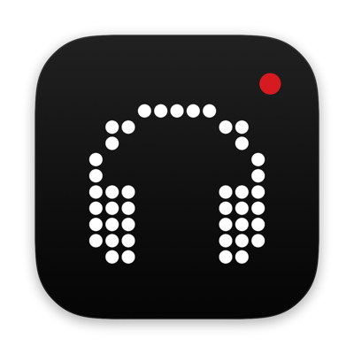
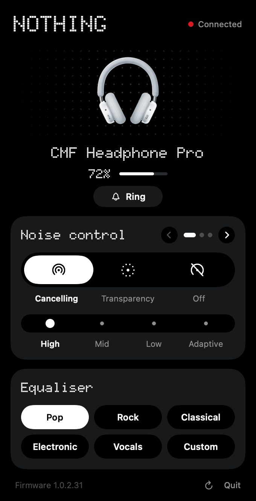
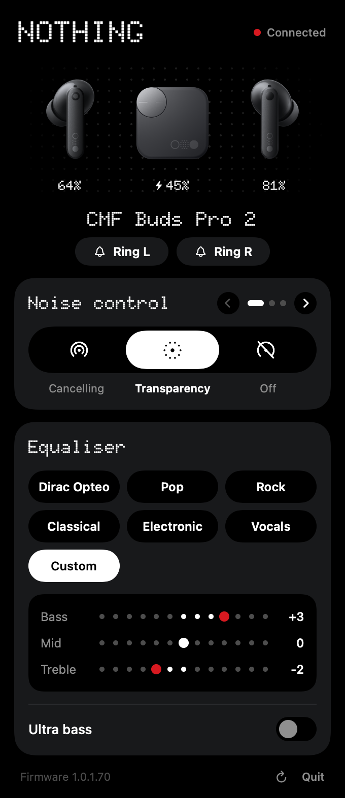
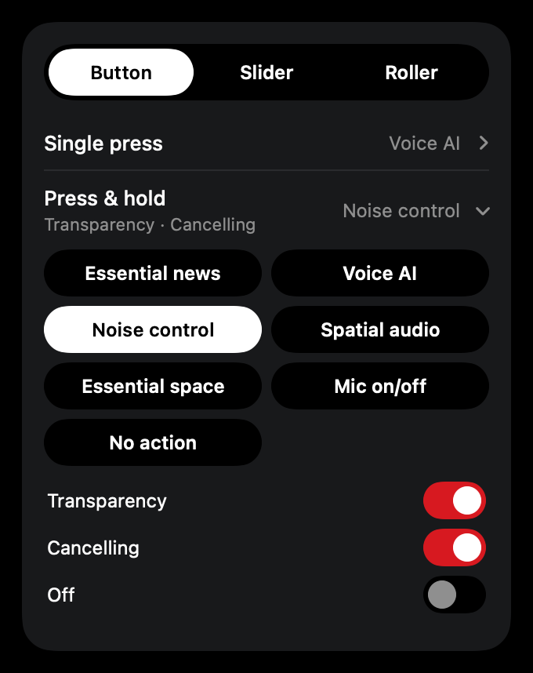

<p align="center"></p>

<h1 align="center">Nothing on Mac</h1>

<p align="center">Control your Nothing and CMF earbuds and headphones from the Mac menu bar.</p>

<p align="center">
  
  &nbsp;
  
</p>

Nothing on Mac puts the Nothing X settings in your menu bar: battery for each bud, the case or
your headphones, noise control, EQ, gestures and the rest, without picking up your phone. It
lives quietly in the menu bar and starts with your Mac.

It's an unofficial app. It isn't made, endorsed or supported by Nothing Technology.

> **Built on ear-web.** Nothing on Mac stands on the work of
> [ear-web](https://github.com/radiance-project/ear-web), which worked out how Nothing and CMF
> devices talk over Bluetooth. If you'd rather use your browser, try it at
> [earweb.bttl.xyz](https://earweb.bttl.xyz/). See [Special thanks](#special-thanks).

## Supported devices

**Nothing:** Ear (1), Ear (2), Ear (stick), Ear, Ear (a), Ear (open), Ear (3), Ear (3a),
Headphone (1), Headphone (1) Pro, Headphone (a)

**CMF:** Buds, Buds Pro, Buds Pro 2, Buds 2, Buds 2 Plus, Buds 2a, Clip Pro, Headphone Pro,
Neckband Pro

The app recognises the exact model and colour, and only shows what that model supports. It has
been tested on real hardware with the CMF Headphone Pro; the other models follow the same
protocol but haven't been tried yet. If something doesn't work on yours, please
[open an issue](https://github.com/mdanishharoon/nothing-on-mac/issues).

## Features

- Battery for each bud and the case, or for your headphones, right in the menu bar
- Noise control: cancelling (with your model's strengths), transparency, off, personalised ANC
- EQ presets, a 3-band custom EQ, advanced parametric EQ (including Headphone (1) Pro's
  precision driver), bass enhance / ultra bass
- Gesture remapping for buds, headphone buttons, sliders, rollers, the smart knob and smart dial

<p align="center"></p>

- Spatial audio, low latency mode, in-ear detection, ear-tip fit test, find my device
- Dual connection with a list of paired devices, audio codec (AAC, LHDC, LDAC), personal sound
- Super Mic, mic mode, walkie-talkie, call transparency, long battery mode, anti-leakage, Ear (1)
  case LEDs

## Install

1. Download the latest `NothingOnMac-x.y.z.dmg` from
   [Releases](https://github.com/mdanishharoon/nothing-on-mac/releases).
2. Open it and drag **Nothing on Mac** into **Applications**.
3. Open it from Applications. macOS will say it can't check the app for malicious software,
   because it isn't notarised by Apple (that needs a paid developer account). Click **Done**, then
   go to **System Settings → Privacy & Security**, scroll down and click **Open Anyway**. You only
   do this once.
4. Allow Bluetooth access when asked.

Connect your earbuds or headphones to the Mac as usual. The app finds them by itself. It turns
on **Open at login** the first time it runs from Applications; you can switch that off in the `…`
menu.

Requires macOS 14 or later, on Apple Silicon or Intel.

### Updates

The app checks GitHub once a day and shows a **Download** button when a new version is out.
Download the new DMG and replace the app in Applications.

## Troubleshooting

**"The device refused the control channel."** Only one app can control the device at a time.
Close the Nothing X app on your phone (or ear-web in a browser) and press **Connect**.

**Nothing shows up.** Make sure the device is connected to this Mac in System Settings →
Bluetooth, not just paired, and that Nothing on Mac has Bluetooth access under Privacy &
Security.

**Logs.** Every packet the app sends and receives is logged:

```sh
/usr/bin/log stream --level debug --predicate 'subsystem == "io.github.mdanishharoon.NothingOnMac"'
```

## Build from source

Needs Xcode (Swift 6) on macOS 14 or later.

```sh
scripts/build-app.sh --open     # builds build/Nothing on Mac.app and launches it
swift test                      # protocol tests
```

macOS remembers Bluetooth permission per code signature. To avoid being asked again after every
build, create a free self-signed signing identity once:

```sh
scripts/create-signing-identity.sh
```

The build scripts use it automatically when it exists. `scripts/release.sh 1.2.3` builds a DMG,
and `--publish` also tags the release and uploads it to GitHub.

The debug build can render the UI without any hardware:

```sh
swift build
NOM_RESOURCES=$PWD/Resources .build/debug/NothingOnMac --render-preview /tmp/previews
```

### How it's organised

- `Sources/HeadphoneProtocol`: packet framing, CRC, commands, the device catalog, per-model
  profiles and config selection. No platform code, fully unit-tested.
- `Sources/NothingOnMac/Device`: a session per connected device and the core features. Each
  feature decides from the model and its config whether it applies.
- `Sources/NothingOnMac/Features` and `Views`: gestures, EQ extras and device settings.
- `Resources/Data`: `catalog.json` (every model and colour) and `ear_config.json` (per-model
  capabilities by firmware).

## Special thanks

This app wouldn't exist without [ear-web](https://github.com/radiance-project/ear-web), the
unofficial web app for Nothing and CMF audio by RapidZapper and Bendix, and everyone who has
contributed device support to it. ear-web did the hard part: reverse-engineering the Bluetooth
protocol and keeping up with every new model Nothing and CMF release. Nothing on Mac borrows
heavily from that work:

- the packet format and every command the app sends and understands
- the device catalog (every model and colour, from ear-web's `control.js`) and the per-model,
  per-firmware capabilities in `Resources/Data/ear_config.json`
- how each model's features, EQ presets and gestures work
- the product images

What's new here is the native macOS app around it: the menu bar UI, Bluetooth handling,
packaging, and the design. If Nothing on Mac is useful to you, please star and support
[ear-web](https://github.com/radiance-project/ear-web) too, and report protocol discoveries
there so every app benefits.

## Credits

The dot-matrix type is [Doto](https://github.com/oliverlalan/Doto) (SIL Open Font License,
`Resources/Fonts/OFL.txt`).

## License and trademarks

AGPL-3.0, like ear-web, which this is derived from.

Nothing, CMF and the product images are trademarks and property of Nothing Technology Limited.
They're used here only to identify compatible products.
